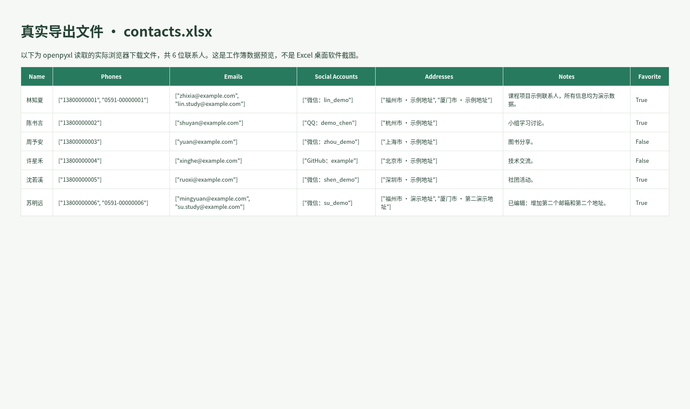
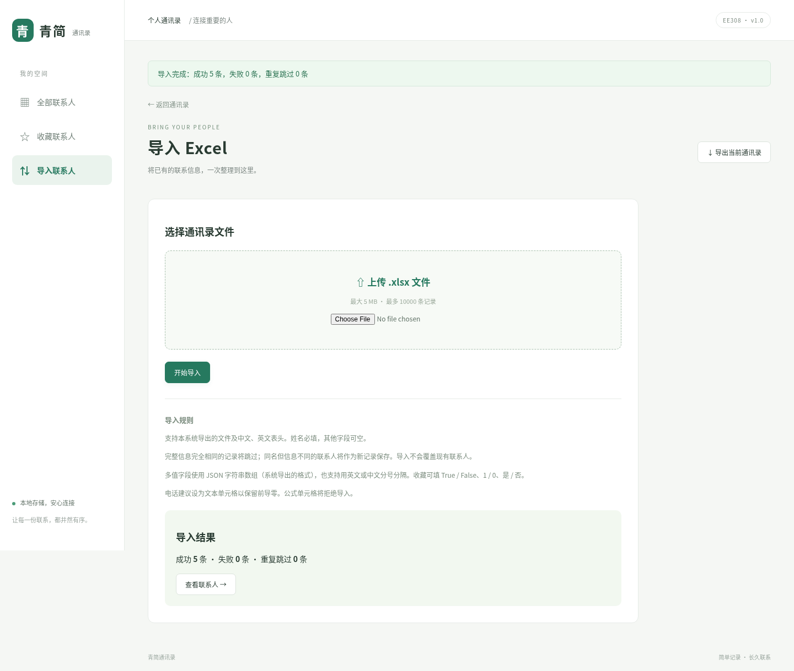
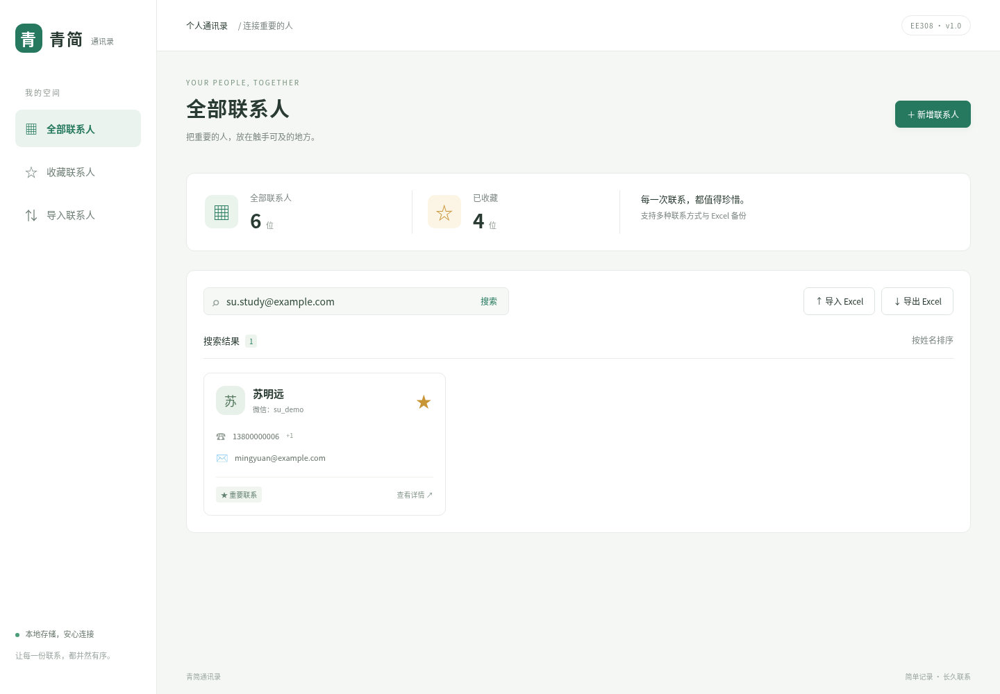
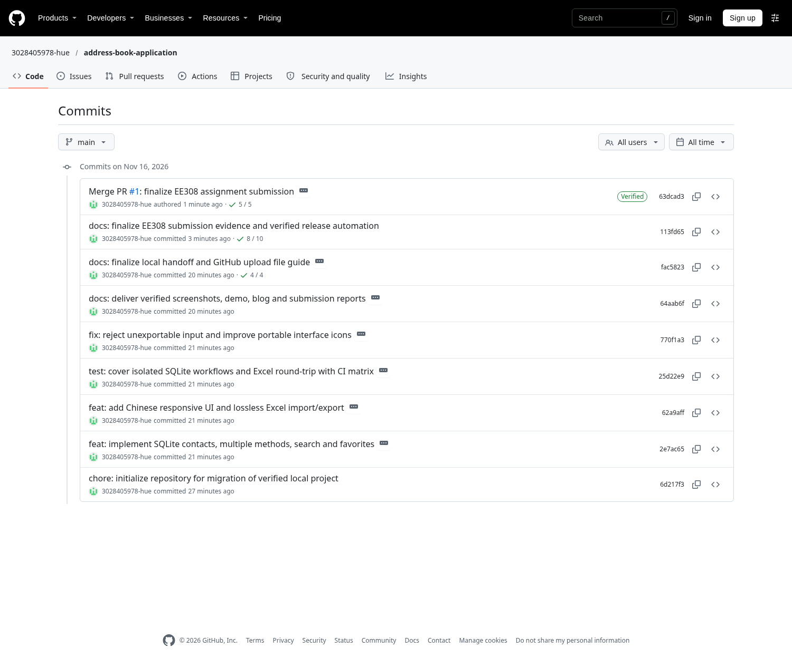
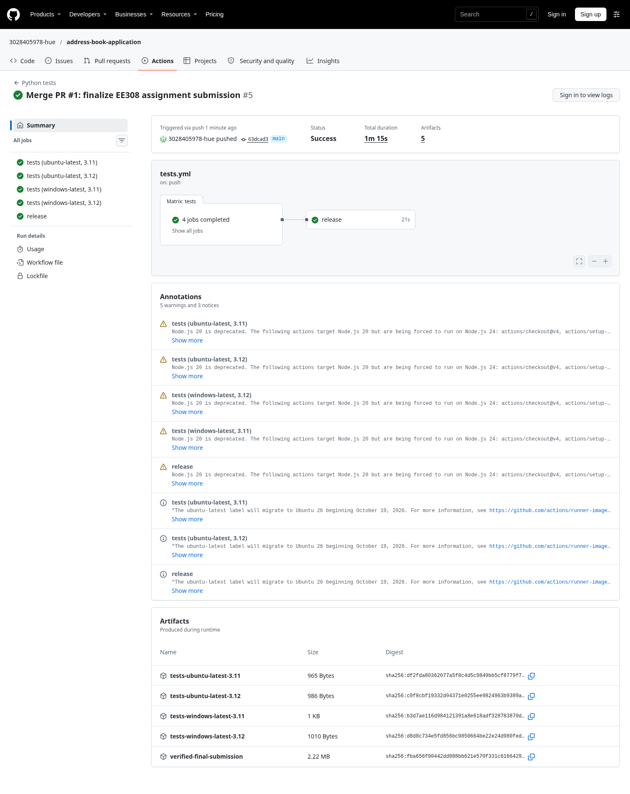

# EE308FZ 软件工程作业：基于 Flask 的 Address Book Application 通讯录系统

## 作业信息

| 项目 | 内容 |
|---|---|
| Course for This Assignment | EE308FZ Software Engineering |
| Team Name | 个人独立项目 |
| Assignment Requirements | [Extreme Programming 作业要求](https://bbs.csdn.net/topics/620593436) |
| Objectives of This Assignment | 实现联系人管理、收藏、多联系方式、Excel 导入导出，并实践 Git 版本管理和软件测试 |
| Other References | [Flask](https://flask.palletsprojects.com/)、[SQLAlchemy](https://docs.sqlalchemy.org/)、[openpyxl](https://openpyxl.readthedocs.io/)、[pytest](https://docs.pytest.org/) |

## 目录

1. 项目简介
2. 项目结构与运行方法
3. 核心功能与实现思路
4. 功能截图
5. 演示视频
6. 测试与验证
7. GitHub 版本管理与 XP 实践
8. 开发问题与解决方法
9. PSP 时间记录
10. 总结

## 1. 项目简介

本次软件工程作业选择开发一个基于 Web 的通讯录系统 **Address Book Application（青简通讯录）**。系统支持联系人新增、查看、编辑、删除、搜索、收藏，以及多条电话、邮箱、社交账号和地址的管理，还支持通过 Excel 导入和导出联系人数据。

项目采用 Python、Flask、Flask-SQLAlchemy、SQLite 和 openpyxl，前端使用 HTML、CSS 与原生 JavaScript。联系人保存在 SQLite 数据库中，关闭网页后不会因页面刷新而丢失。项目为个人独立项目，使用 AI 开发助手辅助编码、测试和材料整理。

- [GitHub 项目仓库](https://github.com/3028405978-hue/address-book-application)
- [代码规范 CODE_STANDARD.md](https://github.com/3028405978-hue/address-book-application/blob/main/CODE_STANDARD.md)
- [正式版本 v1.0.0](https://github.com/3028405978-hue/address-book-application/releases/tag/v1.0.0)
- [下载完整项目 ZIP](https://github.com/3028405978-hue/address-book-application/releases/download/v1.0.0/EE308_Address_Book_Submission_Final.zip)

## 2. 项目结构与运行方法

项目按照应用入口、数据模型、路由、业务服务、页面和测试进行划分：

```text
app.py             Flask 应用入口
config.py          应用配置
models.py          联系人与联系方式数据模型
routes/            联系人管理及收藏功能
services/          输入校验、Excel 导入导出
static/            CSS 与 JavaScript
templates/        HTML 页面
tests/            自动化测试
docs/             截图、视频、测试及提交文档
```

在 Windows 系统中安装 Python 3.11 或更新版本后，可执行：

```bat
python -m venv .venv
.venv\Scripts\activate
python -m pip install -r requirements.txt
python app.py
```

浏览器访问 `http://127.0.0.1:5000` 即可使用。程序首次启动时会初始化所需的数据表。

## 3. 核心功能与实现思路

### 3.1 联系人管理

用户可以新增、查看、修改和删除联系人。每个联系人包含姓名、备注、收藏状态及多种联系方式。表单会检查必填字段和输入长度，删除操作提供确认提示，减少误操作。

### 3.2 多联系方式

系统采用联系人表与联系方式表的一对多关系。联系方式按电话、邮箱、社交账号和地址分类，每位联系人可以保存同一类型的多条记录。前端支持动态添加或删除输入框，后端统一处理空白值和重复值。

### 3.3 搜索与收藏

搜索范围包括姓名、全部电话及全部邮箱，不仅限于列表中显示的主要联系方式。收藏状态单独保存，可通过收藏筛选快速查找重要联系人，也可以与搜索条件组合使用。

### 3.4 Excel 导入导出

系统使用 openpyxl 处理 `.xlsx` 文件。导出时每个联系人占一行，多值联系方式使用 JSON 数组字符串保存，以避免分号、换行等字符造成信息丢失。导入时进行字段校验，统计成功、失败及重复跳过的记录，并处理损坏文件、错误表头等情况。

### 3.5 响应式界面

界面采用中文标签，桌面端显示侧栏与联系人卡片，移动端切换为单列布局。首页提供搜索、添加、导入和导出入口，操作完成后有相应反馈。

## 4. 功能截图

以下图片来自项目运行和 GitHub 页面，演示数据不涉及真实个人联系方式。

### 4.1 通讯录首页


### 4.2 新增联系人


### 4.3 编辑联系人


### 4.4 收藏功能


### 4.5 多联系方式


### 4.6 Excel 导出




导出数据预览由程序读取实际生成的 Excel 文件后展示，不是 Excel 桌面软件截图。

### 4.7 Excel 导入与重复检测




### 4.8 搜索与移动端




## 5. 演示视频

项目已制作实际浏览器操作演示，内容包括联系人导入、新增、编辑、多联系方式、收藏、搜索、导出、重复导入与删除。

**[点击查看或下载项目演示视频 MP4](https://github.com/3028405978-hue/address-book-application/blob/main/docs/video/demo.mp4)**

视频为 GitHub 上的实际文件，未将其描述为已上传到 CSDN 的视频播放器。

## 6. 测试与验证

项目使用 pytest 编写自动化测试，覆盖联系人 CRUD、搜索、收藏、多联系方式、数据持久化、Excel 数据交换及异常输入等场景。

根据仓库中保存的测试报告：

| 检查项目 | 结果 |
|---|---|
| pytest 自动化测试 | 49 passed，0 failed |
| 后端语句覆盖率 | 97% |
| 浏览器功能检查 | 12 项通过 |
| Python 编译检查 | 通过 |
| GitHub Actions | Ubuntu / Windows × Python 3.11 / 3.12 四组通过 |

测试还包括 CSRF 防护、HTML 转义、非法 Excel 文件和导入导出一致性等边界情况。浏览器检查覆盖移动端布局。以上结果来自实际测试日志与 CI 记录，不代表已进行大规模性能或公网部署测试。

- [测试报告](https://github.com/3028405978-hue/address-book-application/blob/main/docs/TEST_REPORT.md)
- [GitHub Actions 成功记录](https://github.com/3028405978-hue/address-book-application/actions/runs/43888265296)

## 7. GitHub 版本管理与 XP 实践

项目使用 Git 记录功能开发、测试补充和文档完善等阶段，GitHub 仓库已有超过三次真实提交。后续还通过 Pull Request 完成最终文档和发布证据的合并。

- [查看 GitHub 提交历史](https://github.com/3028405978-hue/address-book-application/commits/main/)
- [PR #1：最终提交文档](https://github.com/3028405978-hue/address-book-application/pull/1)（已合并）
- [PR #2：发布证据更新](https://github.com/3028405978-hue/address-book-application/pull/2)（已合并）
- [v1.0.0 Release](https://github.com/3028405978-hue/address-book-application/releases/tag/v1.0.0)





本项目借鉴了极限编程（XP）的小步开发、持续测试、简洁设计和重构思想。由于是个人项目，没有结对编程；测试主要在功能开发后补充，因此不将整个过程称为严格的测试驱动开发（TDD）。

## 8. 开发问题与解决方法

**问题一：测试中的 CSRF Token 初始化失败。** 早期测试夹具没有从含表单的页面取得 Token，导致多个提交测试失败。调整夹具后，测试可以正常执行，并补充了输入边界检查。

**问题二：搜索测试出现非预期匹配。** 测试邮箱与另一条邮箱存在子串关系，程序正确匹配了两条数据。修改演示数据为唯一查询条件后，测试结果符合预期。

**问题三：Excel 多值字段容易出现分隔符冲突。** 为避免电话号码、地址或其他字段中的分号影响数据还原，导出统一使用 JSON 数组字符串，确保导入导出的一致性。

**问题四：代码与文档交付需要同步。** 完成核心功能后，继续整理了 GitHub 提交记录、测试证据、PR、Release、截图和演示视频，并通过自动化工作流检查最终项目包。

## 9. PSP 时间记录

作业于 **2026 年 11 月 15 日 16:37** 发布，截止时间为 **11 月 17 日 23:59**。以下 PSP 表采用项目工作量估算，用于分析不同开发阶段的时间分配；其中“模拟实际时间”不是经独立核实的个人工作日志。

| PSP 阶段 | 计划时间（分钟） | 模拟实际时间（分钟） |
|---|---:|---:|
| Planning | 60 | 45 |
| Design | 90 | 75 |
| Coding | 240 | 270 |
| Code Review | 60 | 50 |
| Compile | 20 | 25 |
| Test | 120 | 135 |
| Summary | 100 | 110 |
| **Total** | **690** | **710** |

计划时间为 **11 小时 30 分钟**，模拟实际时间为 **11 小时 50 分钟**，差值 20 分钟，约为计划时间的 2.9%。编码与测试是时间占比最高的两个阶段，说明多联系方式、Excel 数据处理和边界测试需要较多投入。

## 10. 总结

通过本次通讯录项目，我对 Web 应用的数据建模、功能模块划分、输入校验和自动化测试有了更完整的认识。项目不仅实现了联系人管理，还考虑了多值信息的存储、Excel 数据交换和异常输入处理。

在软件工程实践方面，Git 提交、Pull Request、GitHub Actions 和 Release 使项目的开发过程与交付结果更加清晰。后续可以进一步增加分页、用户认证和更完善的备份机制。

本次作业的源代码、测试报告、运行截图、演示视频和正式发布包均保存在 [GitHub 仓库](https://github.com/3028405978-hue/address-book-application)。
