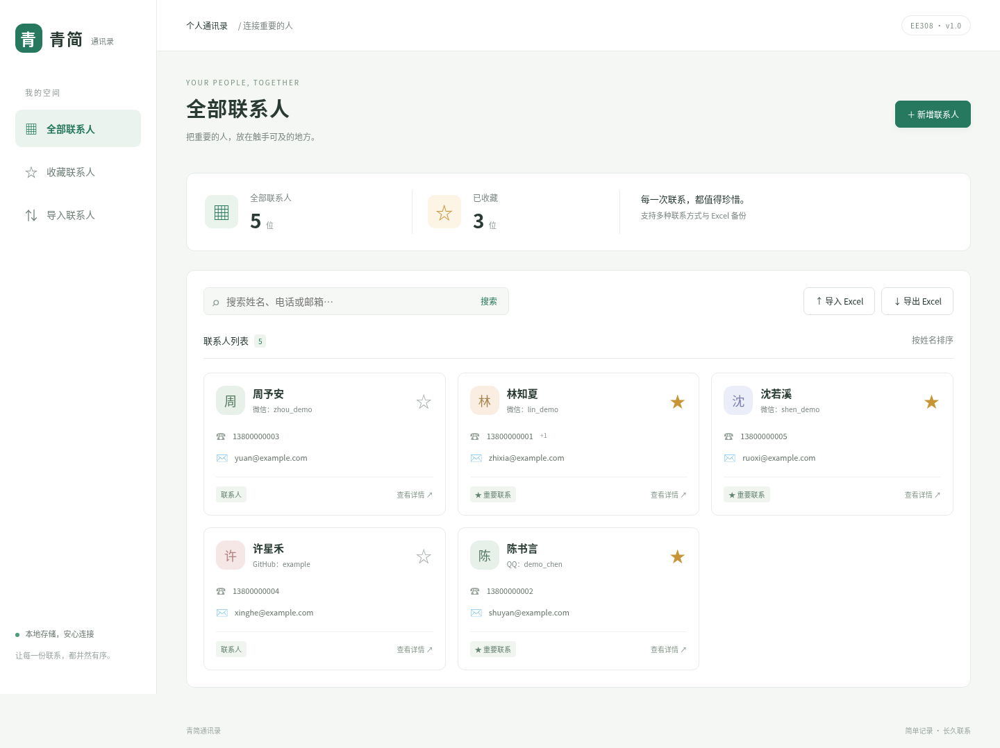
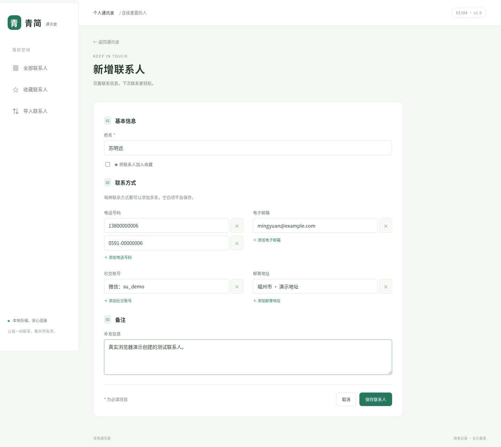
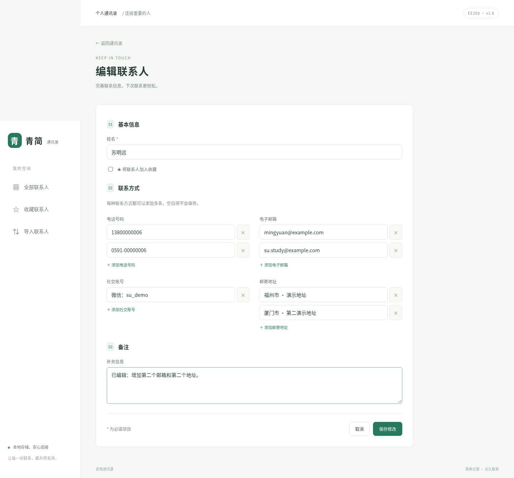
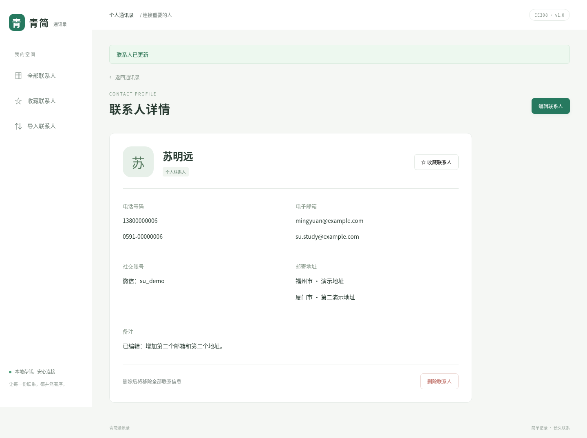
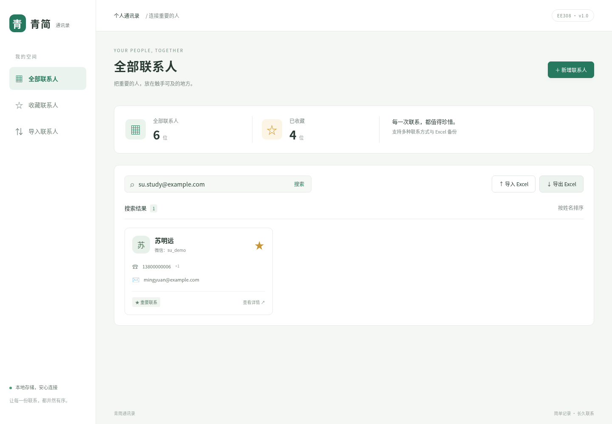
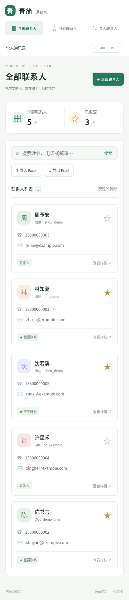
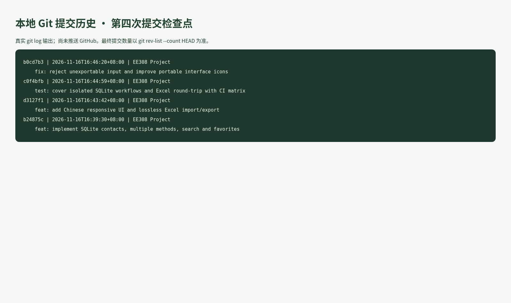

# EE308FZ 极限编程作业：用 Flask 实现青简通讯录

> 发布前核实：这是按第一人称整理的个人博客草稿。项目代码、测试和截图由开发助手在实际环境中执行完成；请本人核对经历、署名和 PSP 工时后发布，未完成的远程事项不能直接改成“已完成”。演示联系人全部是示例数据。

| Item | Content |
|---|---|
| Course for This Assignment | EE308FZ Software Engineering（FZU–MU） |
| Team Name | 个人独立项目 |
| Assignment Requirements | [Extreme Programming](https://bbs.csdn.net/topics/620593436) |
| Objectives of This Assignment | 实现可持久化的通讯录，练习收藏、多联系方式、Excel 交换、自动测试及 Git 分阶段提交 |
| Other References | [Flask](https://flask.palletsprojects.com/)、[SQLAlchemy](https://docs.sqlalchemy.org/)、[openpyxl](https://openpyxl.readthedocs.io/)、[pytest](https://docs.pytest.org/) |

作业截止为 **2026 年 11 月 17 日 23:59（北京时间）**。原始作业提醒博客发布后有审核过程，提交时应留出时间。

## 目录

- [1. 项目简介](#1-项目简介)
- [2. 仓库、结构与规范](#2-仓库结构与规范)
- [3. 功能实现思路](#3-功能实现思路)
- [4. 运行截图](#4-运行截图)
- [5. 演示视频](#5-演示视频)
- [6. 测试结果](#6-测试结果)
- [7. Git 提交与发布](#7-git-提交与发布)
- [8. 开发过程和问题](#8-开发过程和问题)
- [9. PSP 表](#9-psp-表)
- [10. 总结](#10-总结)

## 1. 项目简介

这次课程作业要实现一个通讯录。我把目标定为：联系人能够保存下来，重要的人能快速找到，同一个人的多种联系方式能够完整记录，也能通过 Excel 备份和恢复。

项目使用 Python 3.11+、Flask、Flask-SQLAlchemy、SQLite 和 openpyxl。页面使用 HTML、CSS 和原生 JavaScript，不依赖在线 CDN。界面叫“青简”，包含首页、新增、编辑、详情、收藏筛选和导入页面。启动后只需在浏览器操作，SQLite 在首次运行时自动建表。

这是个人项目，不适用两人分工、贡献比例或合作矛盾的内容。云部署属于额外分，本地可运行不能算公网部署。

## 2. 仓库、结构与规范

仓库地址：[address-book-application](https://github.com/3028405978-hue/address-book-application)。这是指定的独立仓库；老师没有提供可 Fork 的原始仓库，所以没有编造 Fork 关系。

代码规范：[CODE_STANDARD.md](../CODE_STANDARD.md)。远程上传完成后也可通过 [GitHub 代码规范链接](https://github.com/3028405978-hue/address-book-application/blob/main/CODE_STANDARD.md) 查看；当前远程状态以第 7 节为准。

```text
app.py              应用工厂、CSRF、错误处理、Waitress 入口
config.py           环境配置
models.py           联系人与联系方式模型
routes/             联系人和收藏路由
services/           统一校验与 Excel 服务
templates/          中文页面
static/             样式与动态表单脚本
tests/              独立数据库测试
docs/               报告、截图和视频
```

我采用路由与业务服务分开的结构。输入校验集中到一处，这样网页新增、编辑和 Excel 导入使用相同规则。命名遵循 snake_case，所有修改数据的操作使用 POST，测试不接触正式数据库。

Windows 11 运行方式：

```bat
python -m venv .venv
.venv\Scripts\activate
python -m pip install -r requirements.txt
python app.py
```

然后打开 http://127.0.0.1:5000 。PowerShell 可以直接使用 `.\.venv\Scripts\python.exe app.py`，不需要更改执行策略。

## 3. 功能实现思路

### 3.1 数据库设计

联系人表保存 id、姓名、备注和收藏状态；联系方式表保存 contact_id、kind 和 value。两表是一对多关系。kind 区分电话、邮箱、社交账号和地址。

我没有把多个电话直接拼成数据库字符串，因为这样不利于分别编辑和搜索。每条联系方式单独存一行，同一联系人可以有多个相同类型。编辑时根据提交的完整列表替换子记录，删除联系人时由 ORM 级联删除其联系方式。完整设计在 [DATABASE.md](DATABASE.md)。

### 3.2 联系人管理和校验

姓名为空或超过 100 字符时服务端拒绝保存；邮箱、备注和联系方式也有基础格式与长度校验。保存成功后跳转到详情并显示反馈。删除前通过浏览器确认框确认，可以取消。

联系人保存在 SQLite，不是页面内存数组。测试会先创建记录，再用相同数据库路径创建另一个应用实例，检查记录是否仍能读取。这样验证了刷新和重启所依赖的数据持久化路径。

### 3.3 搜索与收藏

搜索同时检查姓名、全部电话、全部邮箱，不只搜索列表卡片显示的第一条。搜索用参数绑定，并对 `%`、`_` 转义，使它们按普通字符匹配。

收藏是 Contact.favorite 布尔字段。切换收藏只修改这个字段，不更新其他信息；收藏列表可以继续叠加搜索。页面上的金色星标便于识别重要联系人。

### 3.4 多联系方式

新增、编辑表单的每类联系方式都有“添加”按钮和删除按钮。JavaScript 使用 DOM API 创建输入框，相同 name 的字段以列表提交；服务端去除空白项和同类重复值。详情页展示全部值，首页只显示主要电话和邮箱，避免卡片过长。

### 3.5 Excel 导入导出

导出每个联系人一行，列为 Name、Phones、Emails、Social Accounts、Addresses、Notes、Favorite。

多值字段统一使用 JSON 字符串数组，例如 `["00123", "13800000000"]`。选择这个规则，是为了不让联系方式里的分号、竖线或换行破坏往返一致性。手工制作的文件也支持中文表头和分号分隔，但数据本身含分号时应采用 JSON。

导入逐行校验，分别统计成功、失败和重复跳过的数量。重复规则是完整规范化记录完全相同才跳过；同名而电话、备注或收藏不同，会作为新联系人保留，不悄悄覆盖。

错误扩展名、损坏文件、缺表头和重复映射列会给出反馈。公式单元格不导入；导出遇到以 `=` 开头的用户文本时明确写成字符串。另有上传大小、解压大小和行数限制，防止错误文件影响服务。

### 3.6 前端页面

页面以浅绿色和白色为主，桌面使用侧栏、统计卡片和联系人卡片；手机切换为顶部导航和单列卡片。搜索、添加、导入、导出集中放在首页，空列表有下一步提示，保存和失败操作都有消息反馈。没有接入外部字体、脚本或 CSS CDN，断网时本地页面仍可使用。

## 4. 运行截图

以下截图由真实 Chromium 浏览器访问运行中的 Flask/Waitress 服务生成。示例姓名、电话、邮箱均为演示数据，邮箱使用 example.com。

### 首页



### 新增联系人



### 编辑联系人



### 收藏筛选


### 多联系方式详情



### Excel 导出




第二张由 openpyxl 读取真实下载的 xlsx 后显示，只是数据预览，不是 Excel 桌面软件截图。

### Excel 导入与重复检测


### 搜索与手机页面




发布到 CSDN 时，需要把这些本地图片上传到编辑器，替换为平台实际图片地址；相对路径不能直接作为公开图片地址。

## 5. 演示视频

已生成 [实际运行 MP4](video/demo.mp4)，内容为真实浏览器操作，没有生成式画面或虚构交互；为了便于阅读，录屏以 0.5 倍速导出。覆盖导入示例、新增、编辑、多联系方式、收藏、搜索、下载、重复导入和删除。服务在录屏前启动，视频未录入终端启动；完整本人讲解与启动录制步骤见 [DEMO_SCRIPT.md](DEMO_SCRIPT.md)。

CSDN 公开视频链接：**待本人上传后填写**。本地 MP4 不能直接当成已发布的视频链接。

## 6. 测试结果

实际测试环境是 Linux、Python 3.12.14。运行：

```bash
python -m pytest -v
python -m compileall .
```

最终结果：**49 项测试全部通过，0 失败**。另外执行覆盖率统计，后端语句覆盖率为 **97%**。所有 pytest 用例使用临时 SQLite 文件，不会改动本地正式通讯录。

| 范围 | 验证重点 |
|---|---|
| CRUD | 必填校验、查看、编辑、删除、子记录清理 |
| 搜索 | 姓名、第二电话、第二邮箱、字面通配符 |
| 收藏 | 收藏/取消、筛选、其他字段不受影响 |
| 多联系方式 | 四类列表、去重、空项清理、完整详情 |
| Excel | 中英文表头、重复规则、损坏文件、公式和多值 |
| 一致性 | 导出后清空，再导入，逐字段比较 |
| 持久化 | 相同 SQLite 路径重建应用后读取 |
| 基础防护 | CSRF、HTML 转义、长度和控制字符限制 |

真实浏览器还通过了 12 项检查，页面 JavaScript 异常数为 0，390px 宽的首页和表单无横向溢出。原始日志与 JUnit XML 见 [TEST_REPORT.md](TEST_REPORT.md)。Windows 和 Python 3.11 的 CI 已配置，但本机没有执行这些环境，不能直接写成验证通过。

## 7. Git 提交与发布

本地最终有 **5 次真实、有意义提交**，分别对应核心逻辑、页面与 Excel、测试与 CI、输入修复和文档证据。具体 SHA 在交付包 git-history.txt；完整历史以 bundle 保留，可以还原检查。



这张截图是第 4 次提交时的真实本地 `git log` 检查点；第 5 次文档提交发生在截图之后，所以截图行数和最终总数不同。它不是 GitHub 网页截图。

- 仓库：https://github.com/3028405978-hue/address-book-application
- main 远程推送：**待 GitHub 认证完成**。已尝试推送，当前认证失败，不能称为上传成功。
- v1.0.0：本地标签和 [Release 说明](RELEASE_NOTES.md) 已准备；正式 GitHub Release **待完成**。
- PR：**待认证后基于真实差异创建**，没有虚构链接或多人审核。
- 云部署：**待云账号授权**；Render API 实际返回 401，暂无公网访问地址。

发布后应把本节状态替换成真实 URL，并补充 GitHub 网页提交历史截图。如何恢复历史和继续发布见 [GIT_STATUS.md](GIT_STATUS.md)。

## 8. 开发过程和问题

我按需求、模型、核心路由、中文界面、Excel、测试、证据和文档的顺序组织项目。实际执行由开发助手完成，我需要在提交前理解代码并核实个人记录。

这次确实遇到的几个问题：

1. **测试夹具没有初始化 CSRF。** 最初夹具访问空首页，那里没有 POST 表单，因此没有生成 token，出现 38 个失败。改为访问新增表单后，原先 43 项通过；补充六项输入边界测试后最终 49 项通过。
2. **演示搜索条件不够唯一。** `study@example.com` 也会匹配 `lin.study@example.com`，应用的子串查询是正确的。修改演示联系人邮箱为 `su.study@example.com` 后，浏览器断言按预期通过。
3. **多值分隔容易丢信息。** 单纯用分号会与地址或社交内容冲突，因此系统导出统一采用 JSON 数组，手工导入才兼容分号。
4. **特殊字符可能导致导出失败。** 控制字符不属于合法 Excel 文本，统一校验阶段就拒绝，并写入回归测试。
5. **外部认证不能靠本地代码解决。** GitHub 的现有令牌失效，Render 未授权，因此如实保留 PENDING，避免把本地运行结果写成公开发布结果。

XP 实践主要体现在简单结构、小步提交、回归测试和集中校验的重构。测试主要是在功能实现后补充，这次不能自称严格的 TDD；也没有结对编程。CI 已配置，远程运行证据还需要实际推送后获取。

## 9. PSP 表

个人实际工时无法由助手运行时长推算，以下请本人核实填写。

| PSP 阶段 | 预计时间（分钟） | 实际时间（分钟） |
|---|---|---|
| Planning | 待填写 | 待填写 |
| Design | 待填写 | 待填写 |
| Coding | 待填写 | 待填写 |
| Code Review | 待填写 | 待填写 |
| Compile | 待填写 | 待填写 |
| Test | 待填写 | 待填写 |
| Summary | 待填写 | 待填写 |
| 合计 | 待填写 | 待填写 |

## 10. 总结

这个项目让我看到，通讯录的难点不只是把表单保存到数据库。多值联系方式怎样存储、Excel 怎样无损恢复、重复记录怎样判断，都需要先写清规则再验证。

简单结构让我更容易追踪一个操作：页面提交给路由，统一校验后更新模型，最后写入 SQLite。测试把这些约定固定下来，也让我能区分程序缺陷、测试夹具问题和演示数据问题。

接下来我希望补充分页、用户认证和更清晰的数据备份流程。提交作业前，我还需要完成 GitHub 和云端授权后的发布、核实 PSP、上传图片视频并发布 CSDN 博客。基础软件已经有实际测试证据，外部提交环节仍要以真实结果为准。
