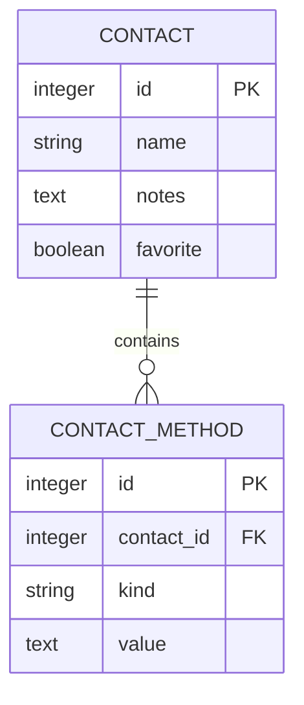

# 数据库设计

Contact.name 为必填且最多 100 字符。ContactMethod.kind 为 phones/emails/socials/addresses，由服务层控制；同类值保持插入顺序。关系配置 all, delete-orphan，删除联系人或编辑移除联系方式时由 ORM 同时清理子行。应用不提供直接 SQL 删除入口。

按姓名、电话、邮箱进行子串查询；收藏筛选与搜索可叠加。收藏切换只更新 favorite，不重建 methods。数据库位置由 DATABASE_URL 控制，默认在 Flask instance 目录。

这是面向课程规模的单用户应用，列表不分页；大量联系人时可增加分页和索引优化，不在此次功能范围内。
