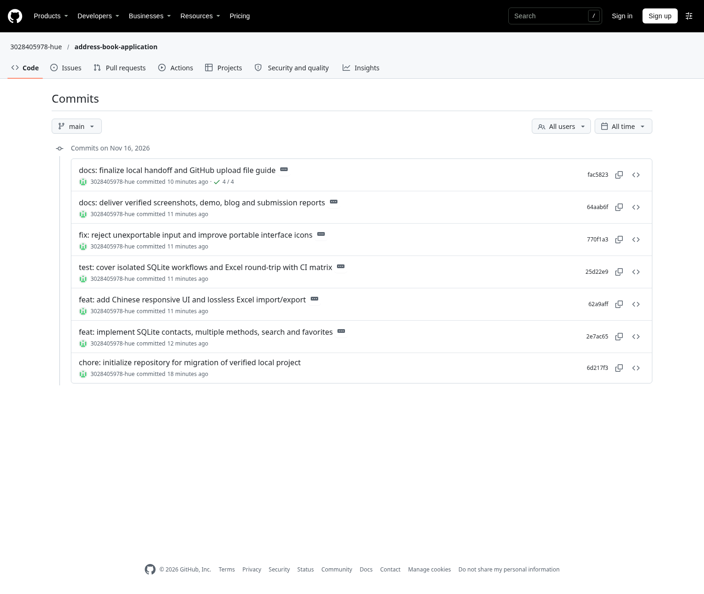

# Git 与远程发布状态

仓库：https://github.com/3028405978-hue/address-book-application。GitHub 连接已获得仓库写入权限，main 已包含完整源码、测试、文档和媒体文件。此前“推送失败/待认证”记录已过时，不再作为当前状态。

## 两套历史的区别

- 原始本地项目：6 次真实提交，最终 SHA `da4837110cd9a8daaeeca5369d75a3731c265d1a`。这套历史仅用于开发溯源。
- GitHub 迁移后的 main：本次收尾核实起点为 7 次提交，SHA `fac58238d8e01afa55e8b5af1673b0edf01c9ccb`。包含一次仓库初始化和六个开发阶段的真实迁移；提交 SHA 与原始本地不同。
- 六阶段迁移后的 Git tree 为 `547495bdbbbc05c4505a05258b81e1cdf433d7c8`，与原本地项目完全一致。通过重新克隆远程仓库验证，59 个受版本管理文件无内容差异。
- 本轮真实修改位于 `docs/final-submission`，用于文档同步、发布流水线和证据整理；不改动应用核心代码。新增提交后的最终数量、SHA 见 [FINAL_DELIVERY.md](FINAL_DELIVERY.md) 及 Release 附带的 FINAL_DELIVERY_RUNTIME.json。

## 真实网页证据

截图来自 https://github.com/3028405978-hue/address-book-application/commits/main/ ，捕获本次收尾起点的 7 次提交。后续文档提交会增加数量，截图是有明确时点的真实网页记录，不冒充最终静态总数。

旧 `11-git-history.png` 是原始本地第 4 次提交检查点，只作历史记录，不冒充 GitHub 页面。

## 发布和 PR

已验证的 CI：https://github.com/3028405978-hue/address-book-application/actions/runs/43884952886，四个 OS/Python 组合成功。真实 PR 和 Release 在完成后更新 [FINAL_DELIVERY.md](FINAL_DELIVERY.md)。当前尚未完成的事项不可因有说明文件而视为发布成功。

老师未提供原始仓库，使用用户指定的独立仓库，没有 Fork 关系，没有多人审核或协作记录。
